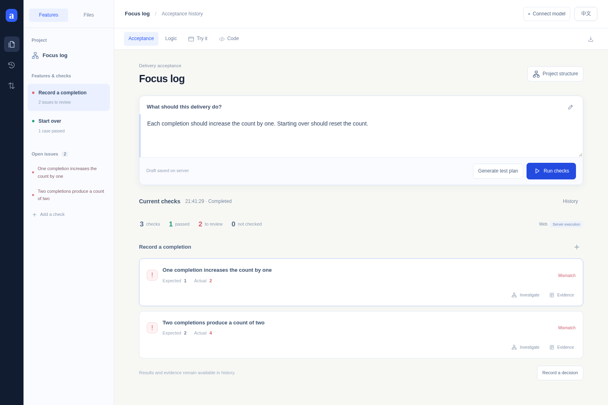
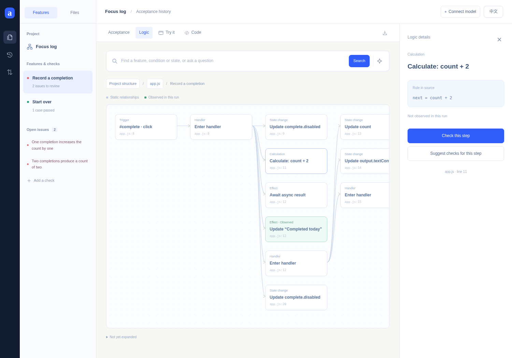
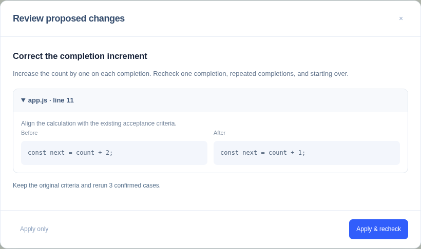
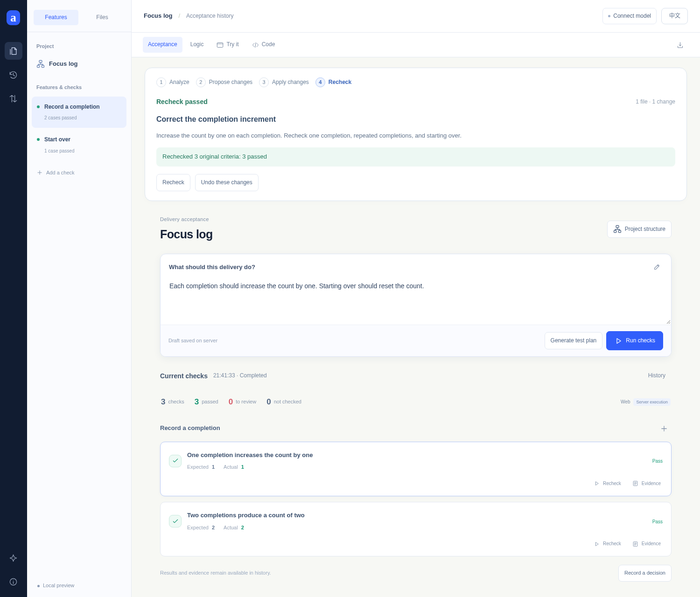

# Aftercode

**From AI-generated code to understood, verified software.**

[中文](./README.zh-CN.md)

## Why Aftercode

When an agent handles implementation, people need a clear way to understand the result, check it against their intent, and guide the next change.

Aftercode brings **requirements, implementation logic, execution evidence and reviewed changes** into one workspace. Start with behavior, follow a result into the logic, and open the source where it matters.

## 1. Describe what should work

Write the expected behavior and compare it with an actual run. Here, one completion should add **1**; the result is **2**.



## 2. Follow the result into the logic

Explore the project, then a feature, its calculations and state changes. The selected rule leads directly to the relevant source line.



## 3. Review the change

Turn the analysis into a concrete modification. Compare the before and after, then choose **Apply & recheck**.



## 4. Recheck the same behavior

The original checks now return **1, 2 and 0**. Keep the criteria, compare runs, and undo a change when needed.



## Run

Requires **Node.js 22+**; Python analysis and execution use `python3`.

```bash
npm ci
npx playwright install chromium
npm start
```

Open **http://127.0.0.1:4173**. Switch **中文 / English** in the header.

Use **Connect model** for explanations and repair proposals. Supported endpoints include OpenAI-compatible services, self-managed models and HKUST APIs. Connection settings are kept in private server storage.

## Capabilities

| Area | Workflow |
| --- | --- |
| Static Web | Browser actions, DOM observations and execution evidence |
| Node.js / Python | JSON input/output checks and execution traces |
| Project exploration | Structure, features, conditions, state changes, search and source navigation |
| Reviewed changes | Workspace edits, version history, undo and rechecks |

## Development

```bash
npm test
npm run check
npm run test:browser
```

[Research and design background](./RESEARCH.md)
