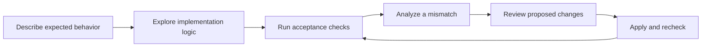

# Aftercode

**AI writes the code. People still need to decide whether it works.**

[中文](./README.zh-CN.md)

## Why this demo exists

AI makes implementation easier to delegate, but not easier to judge. People still have to explain the intended behavior, verify the result, understand a failure, and decide whether to accept a change. Doing that through unfamiliar files, logs and repeated chat can be the harder part of the work.

Aftercode explores an **acceptance-first workspace**: start with what should happen, inspect how it is implemented, and use actual execution evidence to guide the next change. The editor is still there—one layer down, when it is useful.

This is an interaction prototype, not a claim that IDEs or human judgment are obsolete. The [research notes](./RESEARCH.md) explain the background and distinguish evidence from product hypotheses.

## The workflow



- **Understand the project:** move from its structure to a feature, condition, state change and source location; search along the way.
- **Check the delivery:** confirm expectations, run real cases in the background, and compare expected with actual results.
- **Close the loop:** turn an explanation into a source-grounded patch, review the diff, apply it, and rerun the original checks—including regressions.
- **Keep control:** undo changes, compare runs, and make the acceptance decision yourself. Old results never become evidence for a new run.

Switch the interface between **中文 / English** in the header. Your requirements, code, assertion values and saved model responses are not rewritten by a language change.

## Run

Requires **Node.js 22+**; Python analysis and execution also need `python3`.

```bash
npm ci
npx playwright install chromium
npm start
```

Open **http://127.0.0.1:4173**. On Linux, Playwright may also require its documented browser system dependencies.

Choose **Connect model** to enable explanations and repair proposals. Source exploration and execution checks work without a model. Compatible endpoints include OpenAI-style services, self-managed models, and HKUST's current and legacy APIs. Keys stay in the server's private storage—not source control, browser storage or investigation exports.

## What it supports

| Project | Checks |
| --- | --- |
| Static Web | Real browser actions, DOM observations and instrumented execution evidence |
| Node.js / Python | Approved JSON stdin/stdout runs, outputs and available execution traces |
| Larger or service-based projects | Source structure, search and reviewable analysis; not arbitrary service orchestration |

Logic maps describe parsed source; highlighted execution comes from recorded runs. A model suggestion is not a test result, and a passing case is not a human sign-off.

Edits apply to the current workspace copy. Opening a server directory does not silently run it or overwrite the original directory. Run only trusted projects: the command-line runner is **not an OS sandbox**.

## Verify

```bash
npm test
npm run check
npm run test:browser
```

The tests cover unseen projects, real execution, reviewed repairs, failed repairs, rollback conflicts, history retention, language switching, and protection of user data. Model protocol tests use explicit substitutes; those are separate from live-provider validation.

## Inside

`analysis/` extracts structure; `runtime/` executes cases; `domain/` keeps criteria, evidence and edits distinct; `agent/` provides a constrained model gateway; `ui/` connects them into the workflow.

Private settings, source histories, run data, browser installations and generated exports are excluded from the repository.
