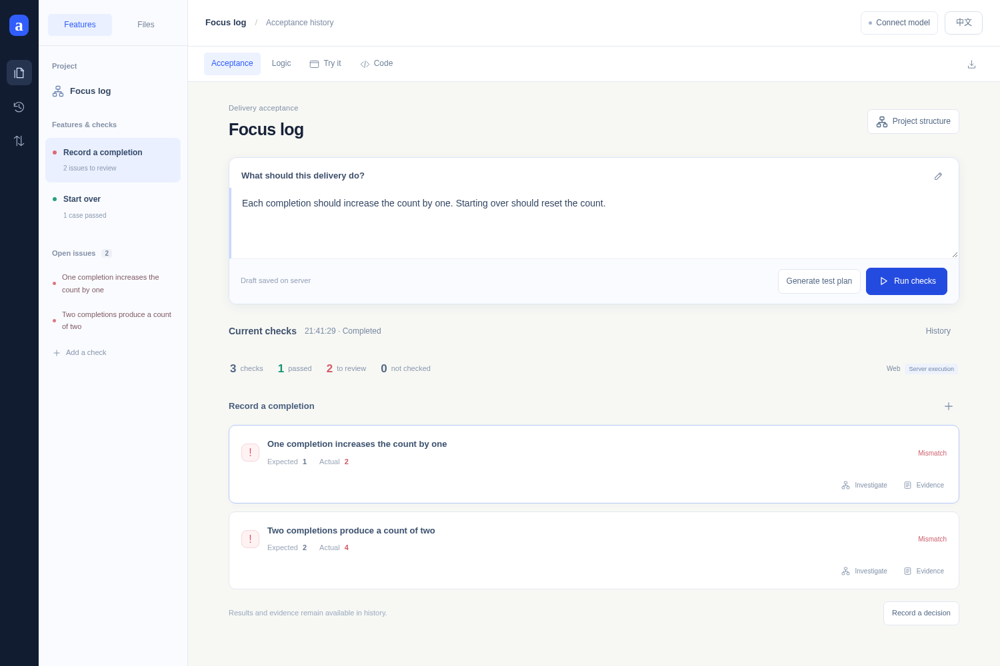
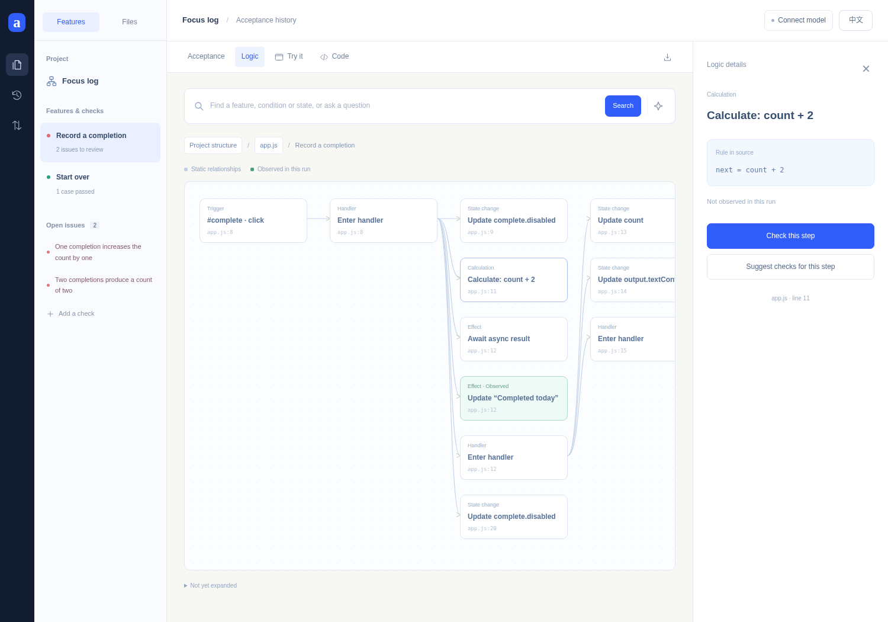
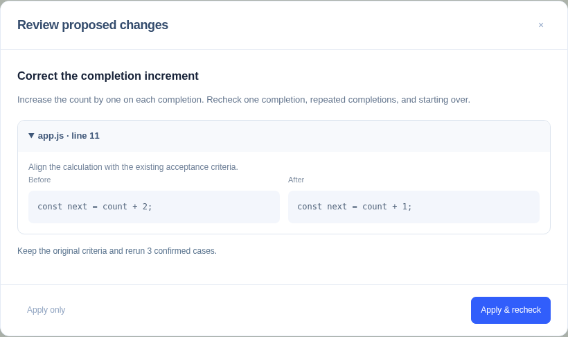
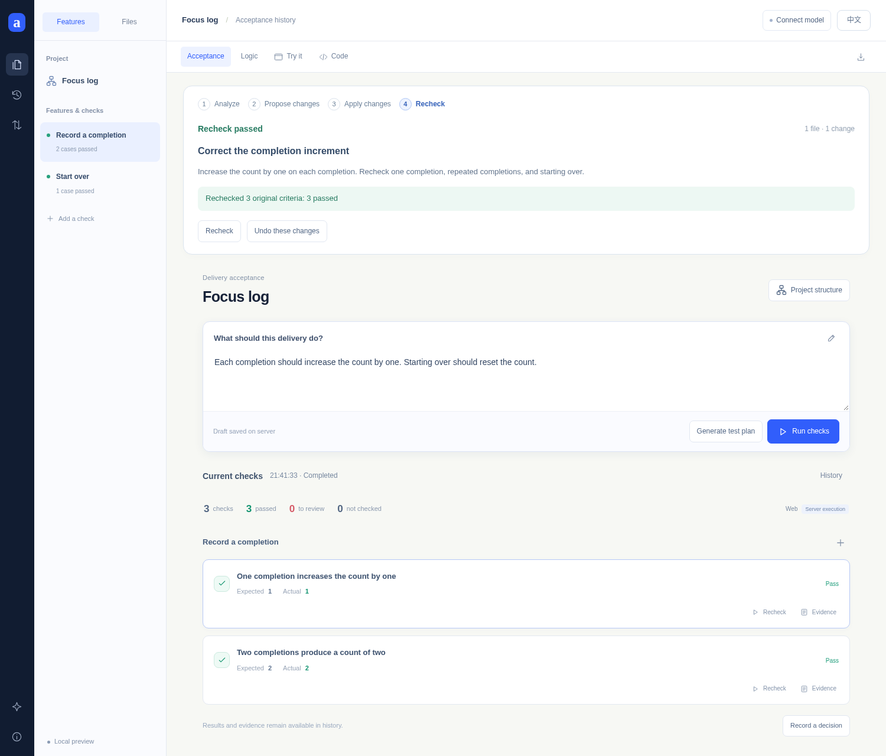

# Aftercode

**AI 写代码，人掌握实现与交付。**

[English](./README.md)

## 为什么做 Aftercode

当实现交给 Agent，人需要清楚地知道：它做了什么，是否满足预期，问题在哪里，下一步怎样修改。

Aftercode 把**需求、实现逻辑、运行证据和修改审阅**放进同一个工作区。从行为开始，沿着结果深入逻辑，在需要时打开具体源码。

## 1. 先表达预期，再看实际结果

用自己的话写下要求，后台执行后直接对照。这次示例中，完成一次应增加 **1**，实际增加了 **2**。



## 2. 沿着问题看懂实现

从项目框架进入功能、计算规则和状态变化，再定位到对应源码。图中的计算规则解释了这次差异。



## 3. 看清改动，再应用

分析之后生成具体修改方案。查看修改前后内容，选择 **Apply & recheck**，把修正接到下一轮验收。



## 4. 用同一套标准重新验收

原有三个检查现在分别得到 **1、2、0**。标准、运行和源码版本一起保留，也可以撤销修改、对照结果。



## 启动

需要 **Node.js 22+**；Python 分析和运行使用 `python3`。

```bash
npm ci
npx playwright install chromium
npm start
```

打开 **http://127.0.0.1:4173**。页头可切换 **中文 / English**。

在页面选择 **连接模型**，即可使用分析和修改方案。支持 OpenAI 兼容服务、自管模型与 HKUST 接口，连接配置保存在服务器私有目录。

## 功能

| 范围 | 工作方式 |
| --- | --- |
| 静态 Web | 浏览器操作、DOM 观察与执行记录 |
| Node.js / Python | JSON 输入输出验收与执行轨迹 |
| 项目探索 | 框架、功能、判断条件、状态变化、搜索与源码定位 |
| 修改闭环 | 工作区修改、版本历史、撤销与重新验收 |

## 开发验证

```bash
npm test
npm run check
npm run test:browser
```

[研究与设计背景](./RESEARCH.md)
